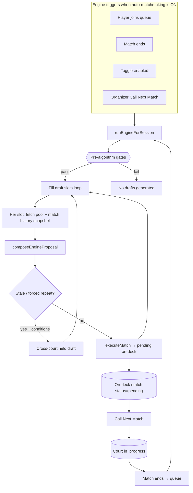
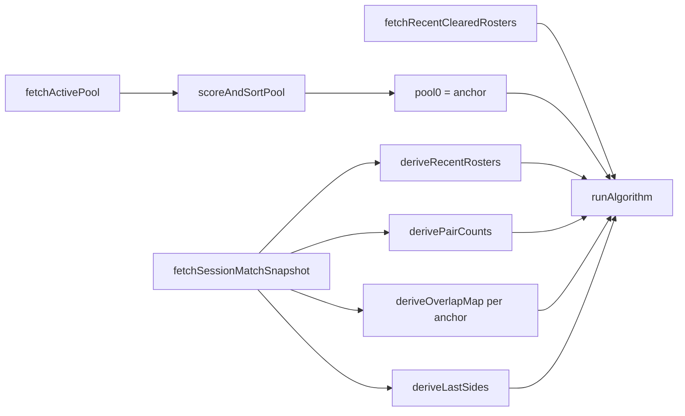
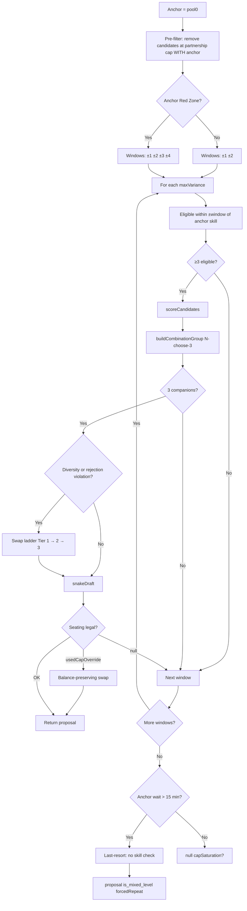
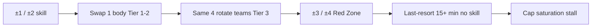

# Matchmaking Engine — Reference

Authoritative reference for how matches are built. Source files:

- `src/app/actions/matchmaking.ts` — orchestrator (`runEngineInternal`, cross-court, promote)
- `src/lib/matchmaking-core.ts` — pure algorithm (`runAlgorithm`, `snakeDraft`, scoring)
- `src/lib/matchmaking-db.ts` — pool fetch, session snapshot, `executeMatch`
- `src/lib/constants.ts` — thresholds (verify here when constants change)

`APP_MANIFEST.md` §3.1 covers integration with the rest of the app. This document is the standalone engine narrative.

---

## Table of Contents

1. [Pipeline overview](#1-pipeline-overview)
2. [Pre-algorithm gates](#2-pre-algorithm-gates)
3. [Skill levels](#3-skill-levels)
4. [Per-slot inputs](#4-per-slot-inputs)
5. [Anchor selection](#5-anchor-selection)
6. [runAlgorithm — who plays](#6-runalgorithm--who-plays)
7. [Team seating — how they sit](#7-team-seating--how-they-sit)
8. [Escalation ladder](#8-escalation-ladder)
9. [Cross-court drafting](#9-cross-court-drafting)
10. [Output flags and side effects](#10-output-flags-and-side-effects)
11. [Constants](#11-constants)
12. [Conflict priority](#12-conflict-priority)
13. [Manual bypass](#13-manual-bypass)

---

## 1. Pipeline overview

The engine is a **queue → on-deck filler**. It never assigns players directly to a court. The organizer promotes a pending (on-deck) match via **Call Next Match** (`callNextMatch` → `promoteOnDeckMatchInternal`).



**Entry points**

| Function | Role |
|---|---|
| `runEngineForSession` | Public trigger; checks toggle; concurrency guard per process |
| `runEngineInternal` | Capacity-limited slot loop; fetches data; calls `composeEngineProposal`; commits |
| `composeEngineProposal` | Steps 1–3: `runAlgorithm` → freshness refresh → shared-games replacement |
| `callNextMatch` | Promote oldest on-deck; if none, run engine with `bypassGate=true` then retry |

---

## 2. Pre-algorithm gates

These run in `runEngineInternal` before `runAlgorithm` is invoked.

| Gate | Rule | Bypass |
|---|---|---|
| Auto-matchmaking toggle | Skip if `is_auto_matchmaking_on = false` | Manual organizer flows |
| Open courts | Need ≥1 non-`closed` court | — |
| Draft cap | Unpublished draft limit by waiting count: **3** (<25), **5** (25–29), **6** (≥30); `max_auto_drafts_override` is a **ceiling** only | — |
| Soft gate | Waiting ≤ `GATE_POOL_THRESHOLD` (4) AND match `in_progress` AND max wait < `GATE_HOLD_MINUTES` (8) AND no Red Zone → defer | `bypassGate` on Call Next Match |
| Pool diversity cap | From **2nd slot**: need ≥ `PLAYERS_PER_MATCH + MIN_FREE_POOL_FOR_ON_DECK` (8) estimated waiters | `bypassGate`; slot 0 always allowed |
| Min pool | ≥ `PLAYERS_PER_MATCH` (4) eligible waiters per slot | — |
| Match snapshot | `fetchSessionMatchSnapshot` must succeed (fail-closed) | — |

**Pool construction** (`fetchActivePool`):

| Filter | Rule |
|---|---|
| Paused | `is_paused = true` → invisible |
| Rest | Returning players need `wait_minutes ≥ MIN_REST_MINUTES` (18); first-game players (`games_played = 0`) exempt; waived if filter would leave <4 players |
| Drafted | Players in unready held drafts excluded from pool |

Each slot **re-fetches** pool and snapshot so sibling drafts from earlier slots in the same burst are visible to diversity and cap logic.

---

## 3. Skill levels

Six tiers from `SKILL_LEVELS` in `src/types/database.ts`. The engine uses `skill_level_int`:

| Label | Int |
|---|---|
| Beginner | 1 |
| Lower Intermediate | 2 |
| Intermediate | 3 |
| Upper Intermediate | 4 |
| Lower Advanced | 5 |
| Advanced | 6 |

Conversion: `skillLevelToInt`.

---

## 4. Per-slot inputs



**Session match snapshot** — single read per slot; all diversity inputs derive from it:

- `deriveRecentRosters` — last `ROSTER_LOOKBACK_COUNT` (10) rosters for `isDiversityViolation`
- `derivePairCounts` — same-team (`partnershipCounts`) and cross-net (`opponentCounts`) session totals; includes `pending` matches
- `deriveOverlapMap` — anchor-specific familiarity weights for `scoreCandidates`
- `deriveLastOpponents` / `deriveLastPartners` — who each player faced/partnered in their **last match only**
- `fetchRecentClearedRosters` — rejection memory (organizer-cleared drafts, TTL 30 min)

Snapshot fails closed: engine stops the burst rather than run with empty history.

---

## 5. Anchor selection

After `scoreAndSortPool`, **`pool[0]`** is the anchor. Sort key is `priorityScore` (desc), tie-break `joined_at` (asc).

### Priority tiers (`computePriorityScore`)

| Tier | Condition | Score |
|---|---|---|
| **Hard Cap** | wait ≥ `HARD_WAIT_CAP_MINUTES` (25) AND games < `HARD_CAP_GAMES_CEILING` (5) | `HARD_CAP_SCORE_FLOOR` (2000) + (wait − 25) × 10 |
| **Red Zone** | wait ≥ `CRITICAL_WAIT_MINUTES` (20) | `RED_ZONE_SCORE_FLOOR` (1000) + wait − (games × `GAME_PENALTY_MINUTES`) |
| **Normal** | wait < 20 | wait − (games × 8); unbounded below zero |

**Red Zone test:** use `isRedZonePlayer` only — never `priorityScore >= RED_ZONE_SCORE_FLOOR` alone (game debt can push score below 1000 while wait ≥ 20).

---

## 6. runAlgorithm — who plays

Pure function in `matchmaking-core.ts`. Returns `AlgorithmResult`: `{ proposal, capSaturation, forcedRepeat?, ... }`.



### 6a. Skill compatibility (`isGroupValid`)

Every pair in the foursome must satisfy `|skill_A − skill_B| ≤ maxVariance`.

| Window | maxVariance | When |
|---|---|---|
| Target | ±1 (`SKILL_VARIANCE_TARGET`) | Always first |
| Max | ±2 (`SKILL_VARIANCE_MAX`) | Normal hard cap |
| Red Zone +1 | ±3 | Red Zone anchor |
| Red Zone max | ±4 (`RED_ZONE_SKILL_VARIANCE_MAX`) | Red Zone last window |
| Last-resort | none | Anchor wait > `FALLBACK_WAIT_MINUTES` (15), all windows failed |

`isMixedLevel = true` when `maxVariance > SKILL_VARIANCE_MAX` or last-resort path.

### 6b. Candidate scoring (`scoreCandidates`)

Lower score = higher priority among skill-valid candidates.

```
Normal:   score = −priorityScore + overlap×10_000 + gamesAhead×10_000
Red Zone: score = −priorityScore + overlap×100    + gamesAhead×100
```

| Term | Meaning |
|---|---|
| `overlap` | From `deriveOverlapMap`; teammate and opponent weights equal (`OVERLAP_WEIGHT_* = 2`) |
| `gamesAhead` | `max(0, games_played − poolMinGames)`; fresh-first among waiters; pulled bodies exempt |
| Red Zone caps | 100× penalties so urgency beats freshness/overlap |

### 6c. Group assembly (`buildCombinationGroup`)

Full **N-choose-3** search over scored candidates. First valid triple (baseline) or argmin over triples when `lastOpponents` is non-empty (split preview + `CONSECUTIVE_OPPONENT_PENALTY`).

At most **one** `isPulled` body per foursome (cross-court).

### 6d. Partnership cap (hard)

- `MAX_PARTNERSHIP_REPEATS = 2` same-team pairings per session
- Pre-filter removes anyone at cap **with the anchor** before grouping
- Counts include completed, in_progress, and **pending** (drafts count immediately)
- **No waivers** — not Red Zone, not last-resort
- Manual organizer assignment is the only bypass

### 6d2. Immediate rematch (hard, `isImmediateRematchPair`)

A pair is an immediate rematch if they shared **either** player's last committed game, either side. `hasImmediateRematch` rejects that four at every engine path: partnership pre-filter, `buildCombinationGroup`, Tier 1/2 swaps, last-resort, freshness, and the final guard before `executeMatch` / `executeHeldMatch`. Red Zone and last-resort do not override it.

When no clean four exists, the engine re-runs with the rematch flag off; `rematchBlocked` is true only if that re-run yields a proposal. Reason precedence: `immediate_rematch` > `session_cap` > `consecutive`.

Kill switch: `MATCHMAKING_NO_IMMEDIATE_REMATCH` (unset/empty = on). `runAlgorithm`'s default `flags` are both off so existing callers stay identical; production reads `readPairRuleFlags`.

### 6e. Diversity (`isDiversityViolation`)

True if **≥3 of 4** proposed IDs appeared together in any single recent roster.

Lookback via `getEffectiveLookback(eligiblePoolSize + 1)`:

| Eligible pool | Lookback |
|---|---|
| ≤5 | 2 |
| 6–9 | 3 |
| 10–15 | 4 |
| 16+ | 7 |

Triggers swap ladder; Tier 3 may accept repeat.

### 6e2. Back-to-back freshness (`runAlgorithmWithFreshness`)

Today's `runAlgorithm` is unchanged. After it serves a four, a wrapper may *replace* that four when it is stale: `forcedRepeat`, or `isBackToBackRepeat` (any of the four would replay ≥3 people from **their own last game**, reconstructed from `lastOpponents ∪ lastPartners`).

The replacement must stay within ±2 skill, keep every Red Zone player already in today's four (engine search only — organizers can still swap anyone), and must not seat anyone further ahead on games, more familiar to the anchor, more than `FRESHNESS_WAIT_SLACK_MINUTES` (10) cheaper on summed wait, or staler across the net. No qualifying four → serve today's four. Kill switch: `MATCHMAKING_FRESHNESS_REFRESH=false`.

### 6e3. Shared-games preference (`findLessRepeatedFour`)

After the existing ladder, if the served four has any pair at `MAX_SHARED_GAMES` (2) shared games (partners + opponents), `composeEngineProposal` searches for a replacement four with a strictly lower over-cap count. Soft: no alternative → original served, `sharedOverCapPairs` reported, and a `shared-games preference: no alternative` warning is logged. When the preference is off, every over-cap count is forced to 0 so cross-court stays byte-identical.

Kill switch: `MATCHMAKING_SHARED_GAMES_PREFERENCE` (unset/empty = on).

### 6f. Rejection memory (`isRejectedRoster`)

Exact four the organizer cleared within `REJECTED_ROSTER_TTL_MINUTES` (30) → treated like diversity violation (stricter than ≥3 overlap — allows 3-of-4 recombinations).

### 6g. Swap ladder (on diversity / rejection)

| Tier | Action | Mixed flag |
|---|---|---|
| **1** | Replace 3rd companion within current skill window | `isMixedLevel` if window > ±2 |
| **2** | Expanded swap at ±`SKILL_VARIANCE_MAX` (only if Tier 1 swap pool empty) | false |
| **3** | `rotatedDraft` — same four, rotate team split | per window |

Red Zone swap **target** is never benched for diversity — engine falls through to seat original group (may flag `forcedRepeat`).

### 6h. Last-resort fallback

When anchor wait > **15 min** and all skill windows failed:

- Skip `isGroupValid` entirely
- Take top 3 candidates by score (at most one pulled body)
- Always `isMixedLevel = true`, `forcedRepeat = true`
- Partnership cap, last-partner ban, and immediate rematch still apply to seating

### 6i. No match

Returns `proposal: null`. `capSaturation: true` when:

- `immediate_rematch` — every remaining group would rematch someone from a last game
- `session_cap` — partnership cap removed too many candidates or seating blocked
- `consecutive` — every balanced split would re-seat last game's teammates (cannot fire while rematch is on)

Organizer receives cap-saturation broadcast.

---

## 7. Team seating — how they sit

`snakeDraft` (normal) and `rotatedDraft` (Tier 3 forced repeat) assign teams via `selectSplit`.

### Split geometry

Players sorted DESC by skill → positions [0,1,2,3]:

| Index | Team A | Team B | Notes |
|---|---|---|---|
| 0 | [0,3] | [1,2] | Snake default — highest+lowest vs 2nd+3rd |
| 2 | [0,2] | [1,3] | Cross-split |
| 1 | [0,1] | [2,3] | Top vs bottom — **only if balanced** |

**Balance gate** (`isBalancedSplit`): team skill gap ≤ `minGap + SKILL_VARIANCE_MAX`. Two highest on same team only when gap equals `minGap`. Bans lopsided high+high vs low+low when mixed splits exist.

### Seating freshness ladder (`selectSplit`)

Four passes, first legal split wins:

| Pass | Partnership | Opponents |
|---|---|---|
| 1a | Both pairs count = 0 | No cross-net pair at `MAX_OPPONENT_REPEATS` |
| 1b | Both pairs count = 0 | Opponent cap relaxed |
| 2a | Both pairs < cap | No cross-net at cap |
| 2b | Both pairs < cap | Opponent cap relaxed |

Within each pass: minimize `countConsecutiveOpponentRepeats` (last-game cross-net repeats).

### Hard seating bans

| Rule | Never waived |
|---|---|
| Last-game partner (`isLastPartnership`) | Same-side teammates from immediately previous match |
| Lopsided stack | high+high vs low+low when balanced mixed splits exist |

### Cap override

If every balanced split is partnership-capped, `snakeDraft` uses `ignorePartnershipCap` pass → `usedCapOverride: true`. Callers (Tier 1/2 swap, preview) skip override; main path may accept after **balance-preserving swap** (replace one companion with another eligible body).

`rotatedDraft` does **not** cap-override — returns null so skill window can expand.

---

## 8. Escalation ladder

When rotation and diversity exhaust options:



| Stage | Leveling | Pairing |
|---|---|---|
| Normal | ±1 → ±2 | Fresh partners preferred |
| Tier 1–2 | Same or ±2 max | One body substituted |
| Tier 3 | Same window | Same four, different split |
| Red Zone ±3/±4 | Cross-tier | `is_mixed_level` |
| Last-resort | Any four by priority | Caps still apply to seating |
| Stall | — | Organizer alert |

---

## 9. Cross-court drafting

When waiting-only four is **stale**:

- `forcedRepeat === true`, **or**
- `countConsecutiveOpponentRepeats > 0` on base split

And: not `bypassGate`, anchor not near Red Zone (`anchorBlocksReach` — wait ≥ 17 or score ≥ 1000), `hasFeedableCapacity`, pullable body available.

**Held draft:** anchor + 2 waiters + **1 body pulled** from live court (`executeHeldMatch`). Three waiters marked `drafted`. Consumes 3 from pool cap math, not 4.

| Constant | Value | Role |
|---|---|---|
| `CROSS_COURT_REST_FALLBACK_MINUTES` | 3 | Min rest after source match ends before hold ready |
| `CROSS_COURT_MAX_HOLD_MINUTES` | 15 | Hold-age cancel (event-driven, not timer) |
| `CROSS_COURT_MAX_UNREADY_HOLDS` | 2 | Max unready holds (draft mode cap no longer bounds these) |

`buildCrossCourtProposal` forces pull into each candidate four (anchor + 2 seat candidates + body); inner `runAlgorithm` on exact four. Discards `forcedRepeat` fours. Accepts only if `pullImprovesFreshness`.

Pull eligibility (`isPullEligible`): streak < `MAX_CONSECUTIVE_GAMES_FOR_PULL`, not already in another held draft.

Red Zone anchor is **never held** — seated immediately.

---

## 10. Output flags and side effects

| Flag / signal | Meaning |
|---|---|
| `is_mixed_level` | Window > ±2 or last-resort |
| `forcedRepeat` | Diversity/rejection failed; Tier 3; Red Zone fall-through; last-resort |
| `capSaturation` | No legal match |
| `capSaturationReason: "immediate_rematch"` | Last-game rematch blocked every four |
| `capSaturationReason: "session_cap"` | Partnership cap |
| `capSaturationReason: "consecutive"` | Last-partner ban blocked all splits |
| `sharedOverCapPairs` | Over-cap pairs in the four actually served (0 when the preference is off) |
| Cap saturation broadcast | Organizer UI via `broadcastCapSaturation` |
| `ON_DECK_WARNING` push | When match auto-published to on-deck |

**Draft vs auto-publish**

| Mode | Cap counts | Publish |
|---|---|---|
| Draft | Unpublished pending minus unready held | Organizer reviews then publishes |
| Auto-publish | Published or held pending | `shouldAutoPublishMatch` → straight to on-deck |

Call Next Match slot 0 with `bypassGate` forces publish regardless of draft mode.

---

## 11. Constants

Verify in `src/lib/constants.ts` — values below are current as of this document.

| Constant | Value | Role |
|---|---|---|
| `PLAYERS_PER_MATCH` | 4 | Doubles |
| `SKILL_VARIANCE_TARGET` | 1 | Preferred skill gap |
| `SKILL_VARIANCE_MAX` | 2 | Normal max gap |
| `RED_ZONE_SKILL_VARIANCE_MAX` | 4 | Red Zone widest |
| `FALLBACK_WAIT_MINUTES` | 15 | Drop skill checks |
| `CRITICAL_WAIT_MINUTES` | 20 | Red Zone |
| `HARD_WAIT_CAP_MINUTES` | 25 | Hard Cap |
| `HARD_CAP_GAMES_CEILING` | 5 | Hard Cap games limit |
| `GAME_PENALTY_MINUTES` | 8 | Priority game debt |
| `MAX_PARTNERSHIP_REPEATS` | 2 | Hard same-team cap |
| `MAX_OPPONENT_REPEATS` | 2 | Soft cross-net cap |
| `MAX_SHARED_GAMES` | 2 | Soft either-side shared-game preference |
| `MIN_REST_MINUTES` | 18 | Post-game rest |
| `GATE_POOL_THRESHOLD` | 4 | Soft gate pool size |
| `GATE_HOLD_MINUTES` | 8 | Soft gate release |
| `MIN_FREE_POOL_FOR_ON_DECK` | 4 | Pool diversity cap increment |
| `GAMES_AHEAD_PENALTY` | 10_000 | Fresh-first |
| `GAMES_AHEAD_PENALTY_RED_ZONE` | 100 | Red Zone fresh-first cap |
| `CONSECUTIVE_OPPONENT_PENALTY` | 3 | Split preview tie-break |
| `FRESHNESS_WAIT_SLACK_MINUTES` | 10 | Max summed wait the refresh may spend |
| `REJECTED_ROSTER_TTL_MINUTES` | 30 | Rejection memory |
| `ROSTER_LOOKBACK_COUNT` | 10 | Snapshot fetch depth |
| `SESSION_MATCH_SNAPSHOT_CEILING` | 200 | Max matches in snapshot |

To count Red Zone call sites: `rg -c 'isRedZonePlayer\(' src/`

---

## 12. Conflict priority

Strongest to weakest:

1. Hard Cap / Red Zone anchor ordering
2. Immediate rematch + partnership cap + last-partner ban (hard seating)
3. Skill window (until widened or dropped)
4. Diversity + rejection memory → swap → rotate → accept
4b. Back-to-back freshness refresh (may replace a stale four; cannot stall)
4c. Shared-games preference (may replace an over-cap four; cannot stall)
5. Fresh-first (`gamesAhead`)
6. Overlap map (anchor familiarity)
7. Opponent cap + consecutive-opponent freshness (soft seating)
8. Team balance (mixed splits over lopsided)
9. Wait time within fairness tier (tie-break only)

---

## 13. Manual bypass

| Action | Effect |
|---|---|
| Organizer manual roster | Bypasses every engine cap; the builder warns on last-game, shared ≥2, teammate, and opponent repeats |
| `callNextMatch` / `bypassGate` | Skips soft gate and pool diversity cap |
| Clear / publish drafts | Manages rejection memory and cap slots |

---

## Related tests

| Area | Location |
|---|---|
| Pure algorithm | `tests/unit/matchmaking-core.test.ts` |
| Engine orchestration | `tests/unit/matchmaking-engine.test.ts` |
| Snapshot derivations | `tests/unit/matchmaking-snapshot.test.ts` |
| Integration | `tests/integration/matchmaking.test.ts` |
| Replay harness | `scripts/replay/simulate.ts` |
| Immediate rematch | `tests/unit/pair-repeat-r1.test.ts` |
| Shared-games preference | `tests/unit/pair-repeat-r2.test.ts` |
| Manual-builder warnings | `tests/unit/repeat-pairing.test.ts`, `tests/unit/pair-rule-wrapper.test.ts` |
